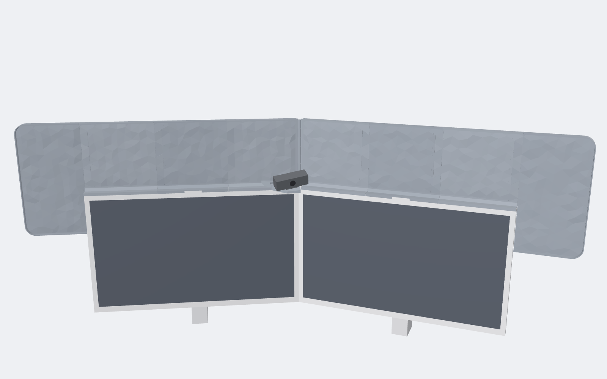
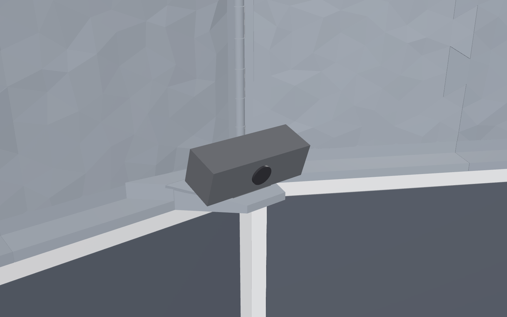

# LG-ultrafine-5k-sun-shades
3D model for 3D printed sun shade custom designed for two 27" LG Ultrafine 5K monitors (27MD5KL-B), optimized for Bambu P2S

It clips onto each monitor's top edge, rises 8 in, reaches 7 in past each outer side, and carries a shelf for a Logitech MX Brio webcam where the monitors meet.

**3D viewer:** [recscue.github.io/LG-ultrafine-5k-sun-shades](https://recscue.github.io/LG-ultrafine-5k-sun-shades/). Drag to orbit, scroll to zoom.

## Files

- `stl/test-coupons/`: print these first. They test the dovetail fit at three clearances, marked by 1, 2 or 3 notches.
- `stl/1-notch_0.10mm/`, `stl/2-notch_0.15mm/`, `stl/3-notch_0.20mm/`: a complete set of 11 print files at each clearance. Print only the folder matching the coupon pair that fit best. Files are numbered from each monitor's outer edge toward the middle, and `0_fit-test-clip_print-first.stl` goes first.
- `PRINTING.md`: print settings, assembly steps and the measurements to check before printing.
- `renders/`: still views of the spine, seams, corner and webcam shelf.
- `src/`: the parametric model. `python src/build.py` regenerates the STLs (needs `manifold3d`, `trimesh`, `numpy`, `scipy`).

